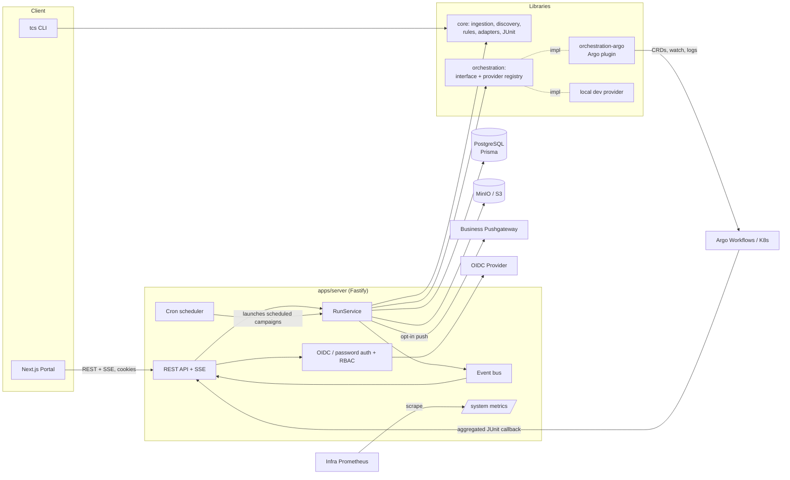
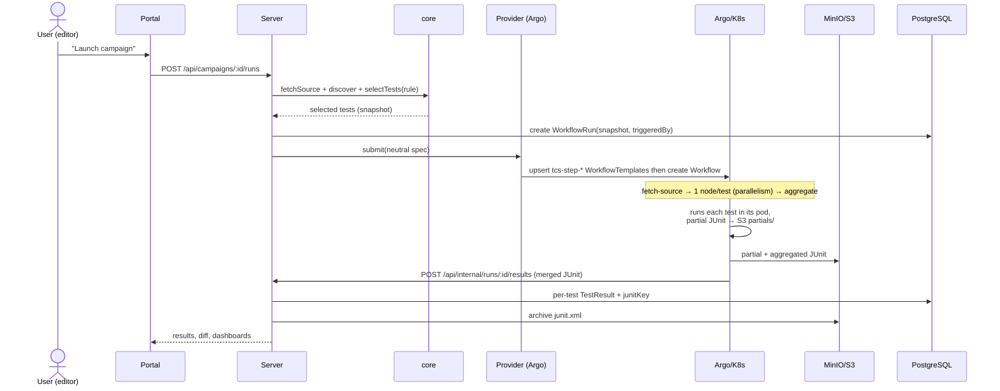
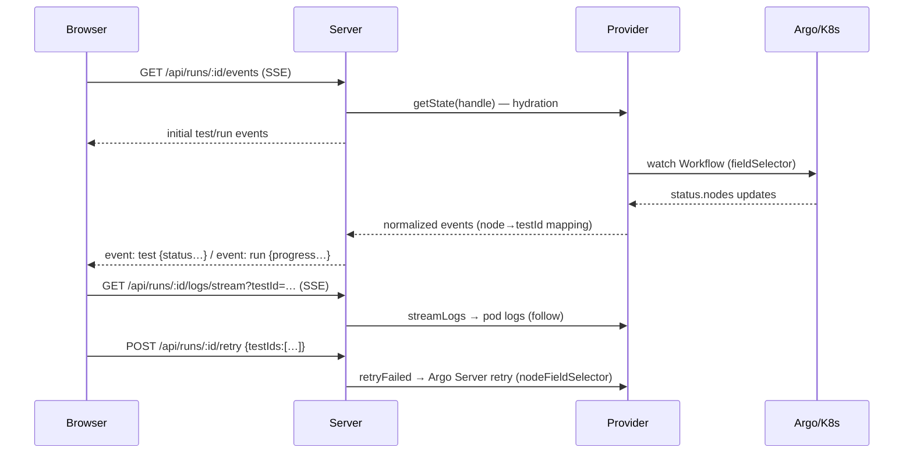
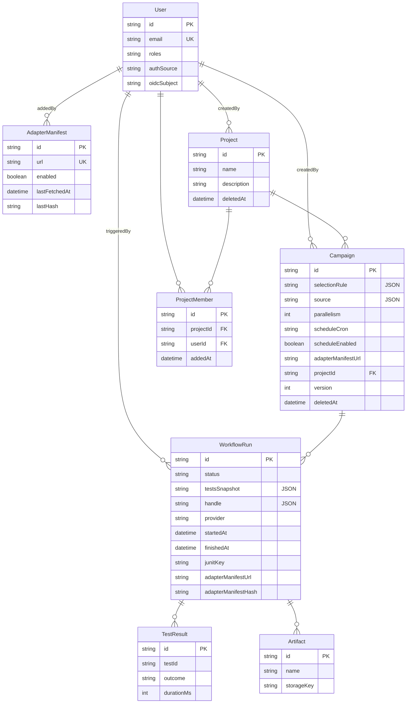

# Architecture documentation

> The concrete deployment of each component and the per-provider topologies
> (`local` / `docker` / `argo`) are described in [deployment.md](deployment.md).
> For an exhaustive, mechanical map of each component's code (full directory
> trees, every route/DB table/interface) rather than the rationale and
> diagrams below, see [BACKEND_ARCHITECTURE.md](BACKEND_ARCHITECTURE.md),
> [FRONTEND_ARCHITECTURE.md](FRONTEND_ARCHITECTURE.md),
> [CLI_ARCHITECTURE.md](CLI_ARCHITECTURE.md) and
> [SHARED_PACKAGES_ARCHITECTURE.md](SHARED_PACKAGES_ARCHITECTURE.md).

## Components

**Key abstraction boundary**: everything touching Argo/Kubernetes lives in
`packages/orchestration-argo`. The rest of the system only ever handles
neutral types (normalized states, an opaque `RunHandle`). Swapping the
orchestrator = a new package + `ORCHESTRATION_PROVIDER=<name>`.

## Campaign execution sequence

## Real-time tracking flow

The server only ever pushes **normalized states** provided by the provider
to the portal — the portal works identically with the `local` provider.

## Data model

## Technology choices (rationale)

| Choice                                                                           | Why                                                                                                                                                                                                     |
| -------------------------------------------------------------------------------- | ------------------------------------------------------------------------------------------------------------------------------------------------------------------------------------------------------- |
| **Node.js + TypeScript** (vs Python)                                             | one stack across portal/server/CLI, **end-to-end shared types** (Zod + Prisma), mature official k8s client, I/O-bound workload (API/watch/SSE) — execution scalability lives in Argo, not in the server |
| **Fastify**                                                                      | performance, schemas, plugins (cookies/CORS), built-in pino logger                                                                                                                                      |
| **Prisma + PostgreSQL**                                                          | versioned migrations, generated types; JSON stored in text columns to stay portable                                                                                                                     |
| **Argo Workflows**                                                               | native fan-out (`parallelism`), per-node retry, S3 artifacts, API-drivable CRDs — **delegates** parallel execution                                                                                      |
| **Containerized execution everywhere**                                           | Argo: one pod per test; `docker` provider: `docker run` with the same image/contract (`/workspace`, env, timeout, resources) — dev behavior mirrors prod                                                |
| **1 DAG task per test** (vs `withItems`)                                         | stable, deterministic node identity → reliable targeted retry, trivial log/result correlation                                                                                                           |
| **SSE** (vs WebSocket)                                                           | server→client unidirectional is enough, passes through HTTP proxies, native `EventSource`                                                                                                               |
| **JUnit XML**                                                                    | universal exchange format across test engines                                                                                                                                                           |
| **Declarative adapter manifests** (see [adapter-plugins.md](adapter-plugins.md)) | extends/overrides engines at runtime without a redeploy — no downloaded code ever executed, same `ResolvedExecution` contract every provider already consumes                                           |

## Security & RBAC

- **Application-level**: httpOnly JWT sessions (HS256, `SESSION_SECRET`),
  roles `viewer < editor < admin`; mutating a campaign is restricted to its
  creator or an admin; OIDC with state+nonce; secrets only via env/Secret.
- **Projects** (API/portal only — docs/functional.md): an orthogonal
  visibility layer on top of the roles above, not a replacement for them. A
  campaign with a `projectId` is only visible to that project's creator,
  members, and `admin`s; a campaign with none keeps the plain role-based
  behavior. `admin` always bypasses the restriction (same as it already
  bypasses campaign ownership) — it's a visibility scope, not a fourth
  role.
- **Kubernetes**: dedicated ServiceAccount, a Role limited to
  `workflows/workflowtemplates` + read-only `pods(/log)` in the Argo
  namespace (see `deploy/helm/*/templates/rbac.yaml`); the git token is
  injected via a Secret and **never** logged (redacted at ingestion).
- **Internal callback**: optional `INTERNAL_CALLBACK_TOKEN` token — when
  set, every emitter (local/docker providers and the Argo aggregation step)
  sends the `x-tcs-token` header, verified by the server (cluster-internal
  network only by default).
- **Adapter manifests**: managing them (instance-level or attaching one to a
  campaign) is **admin-only** — a manifest-defined engine can run arbitrary
  commands, including directly on the server host under the `local` process
  provider. See [adapter-plugins.md §8](adapter-plugins.md#8-security-posture).

## Scalability & resilience

- Test execution scales **horizontally inside Kubernetes** (one pod per
  test, throttled by the Workflow's `parallelism`) — the server only
  orchestrates.
- Watch with **reconnection + resync** (`getState`); state persisted at
  terminal transitions; result ingestion is **idempotent** (upsert by
  `(runId, testId)`). The **aggregated JUnit report is authoritative**: at
  ingestion, the run status is reconciled if the watch missed the end, and
  S3 archiving is best-effort (results are never lost). At startup,
  interrupted runs' watches are re-attached (argo) or the runs are closed as
  errors (in-memory providers).
- An isolated test failure never stops the rest (`failFast:false`);
  aggregation **always runs**; per-test timeouts (`activeDeadlineSeconds`).
- Business metrics are **pushed to a dedicated target** (Pushgateway) to
  isolate cardinality from the infra Prometheus; labels limited to
  campaign/run (per-test detail stays in the DB + JUnit).
- Current accepted limitation: the event bus **and the cron scheduler** are
  in-process (a single server instance); scaling to N instances means an
  external pub/sub (Redis) in `RunEventBus` and the scheduler active on only
  one replica (`SCHEDULER_ENABLED`), or a distributed lock.
